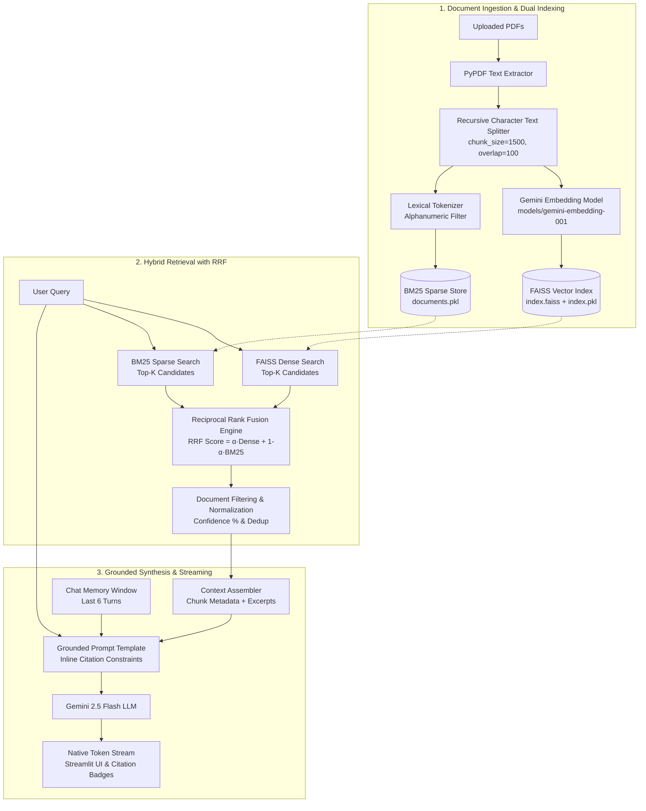

<div align="center">

# 📜 Parchment.ai

### Enterprise Multi-Document Hybrid RAG Engine with Reciprocal Rank Fusion (RRF) & Gemini 2.5 Flash

[](https://parchmentai.streamlit.app/)
[](https://www.python.org/)
[](https://streamlit.io/)
[](https://www.langchain.com/)
[](https://ai.google.dev/)
[](https://github.com/facebookresearch/faiss)
[](LICENSE)

<p align="center">
  <b>A state-of-the-art Retrieval-Augmented Generation (RAG) platform delivering hallucination-resistant question answering across heterogeneous PDF libraries through dual-track dense + sparse fusion and real-time token streaming.</b>
</p>

[Key Features](#-key-features) • [Architecture](#-system-architecture) • [Mathematical Foundation](#-mathematical-foundation--rrf-algorithm) • [Directory Structure](#-repository-structure) • [Installation](#-installation--setup) • [Configuration](#-configuration)

</div>

---

## 🌟 Overview

**Parchment.ai** addresses the classic failure modes of naive vector search—such as missed exact-term queries, out-of-vocabulary technical jargon, and lost context in long-tail PDFs. By pairing high-dimensional semantic embeddings from **Google Gemini** with token-exact **BM25 lexical scoring**, merged via **Reciprocal Rank Fusion (RRF)**, Parchment provides pinpoint retrieval accuracy with strict, verifiable in-text citations.

---

## 🚀 Key Features

* **Dual-Track Hybrid Retrieval Engine**:
  * **Dense Semantic Vector Search**: Powered by `models/gemini-embedding-001` indexed in high-performance FAISS vector spaces.
  * **Sparse Lexical Search**: Full-text BM25 Okapi index for exact alphanumeric match, acronyms, and keyword precision.
  * **Reciprocal Rank Fusion (RRF)**: Merges non-comparable similarity scores using rank positions with tunable $\alpha$-weighting.
* **Dynamic Search Tuner ($\alpha$-Balance Slider)**:
  * Adjust retrieval profile in real time: from pure BM25 lexical match ($\alpha = 0.0$), to balanced hybrid ($\alpha = 0.5 - 0.65$), to pure semantic vectors ($\alpha = 1.0$).
* **Real-Time Token Streaming**:
  * Native generator-driven streaming powered by `gemini-2.5-flash` with zero simulated delays or block buffering.
* **Strict Grounding & In-Text Citations**:
  * System prompt constraints enforce bracketed citations: `[Source: document.pdf, Page X]` linked directly to source passages.
* **Granular Document Filtering**:
  * Seamlessly toggle queries across the global knowledge base or isolate context to an individual target document.
* **Interactive Source & Score Inspector**:
  * Expandable source audit cards displaying confidence scores (e.g., $97.4\%$), match types (`Dense`, `Keyword`, or `Hybrid`), chunk offsets, and full raw text excerpts.
* **Multi-Format Conversational Export**:
  * One-click exports of conversational transcripts with embedded citations to **Markdown (.md)**, **JSON (.json)**, and **Plain Text (.txt)**.
* **Persistent Knowledge Base**:
  * Both FAISS indices and BM25 document stores are serialized on disk, allowing instant hot-reloading without re-embedding upon application restart.

---

## 🏗️ System Architecture



---

## 🧮 Mathematical Foundation & RRF Algorithm

Standard RAG architectures struggle when combining dense embeddings with sparse scores because Euclidean distances ($L_2$) and BM25 scores exist on vastly disparate, uncalibrated numerical scales. 

Parchment.ai solves this by implementing **Reciprocal Rank Fusion (RRF)**:

### 1. Reciprocal Rank Fusion Formula
For any chunk $d$ in the union of candidate document sets:

$$RRF(d) = \alpha \cdot \sum_{d \in R_{\text{dense}}} \frac{1}{k + r_{\text{dense}}(d)} + (1 - \alpha) \cdot \sum_{d \in R_{\text{bm25}}} \frac{1}{k + r_{\text{bm25}}(d)}$$

Where:
* $r_{\text{dense}}(d)$ is the 1-based rank position of document $d$ in dense FAISS similarity search.
* $r_{\text{bm25}}(d)$ is the 1-based rank position of document $d$ in BM25 scoring.
* $k$ is the smoothing constant (default: $k = 60$), mitigating the outsized impact of high ranks from either retriever alone.
* $\alpha \in [0.0, 1.0]$ is the user-controlled weight slider.

### 2. Normalized Relevance Scoring
To provide an interpretable match metric in the user interface, each retrieved chunk is assigned a normalized confidence percentage:

$$\text{Confidence}(d) = \min\left(99.0, \max\left(52.0, \frac{RRF(d)}{RRF_{\text{theoretical\_max}}} \times 100\right)\right)$$

Where $RRF_{\text{theoretical\_max}} = \frac{\alpha}{k + 1} + \frac{1 - \alpha}{k + 1} = \frac{1}{k + 1}$.

---

## 📁 Repository Structure

```text
multiPDF-RAG/
├── app.py                     # Streamlit frontend & reactive application lifecycle
├── config.py                  # Environment variable validation & credentials loader
├── requirements.txt           # Production dependency specifications
├── README.md                  # Comprehensive architectural & operational guide
├── assets/
│   └── styles.css             # Plus Jakarta Sans typography & glassmorphic styling
├── utils/
│   ├── hybrid_search.py       # HybridRetriever class with BM25, FAISS, & RRF logic
│   ├── rag_pipeline.py        # Token stream generator & prompt assembly pipeline
│   ├── vector_store.py        # FAISS creation, persistence, and chunk serialization
│   ├── llm.py                 # Gemini 2.5 Flash LLM client factory
│   ├── embeddings.py          # Google Generative AI Embeddings interface
│   ├── prompt.py              # Strict grounded prompt templates with citation constraints
│   ├── pdf_reader.py          # PyPDF extractor with whitespace normalization
│   ├── text_splitter.py       # Recursive text chunker with enriched metadata
│   ├── chat_memory.py         # Conversational sliding window history formatter
│   └── export_chat.py         # Multi-format serializers (TXT, Markdown, JSON)
└── vector_db/                 # Persistent on-disk vector store
    ├── index.faiss            # Quantized FAISS vector index
    ├── index.pkl              # FAISS InMemoryDocstore mapping
    └── documents.pkl          # Serialized document chunks for BM25 persistence
```

---

## ⚙️ Installation & Setup

### Prerequisites
* **Python**: 3.10, 3.11, or 3.12
* **Google AI Studio API Key**: [Get a Gemini API Key](https://aistudio.google.com/)

### 1. Clone & Navigate
```bash
git clone https://github.com/annushka1911g-max/Parchment.ai.git
cd multiPDF-RAG
```

### 2. Create Virtual Environment
```bash
python3 -m venv .venv
source .venv/bin/activate       # macOS/Linux
# .venv\Scripts\activate        # Windows
```

### 3. Install Dependencies
```bash
pip install --upgrade pip
pip install -r requirements.txt
```

### 4. Configure Environment Variables
Create a `.env` file in the project root:
```bash
cp .env.example .env
```
Populate `.env` with your API key:
```env
GOOGLE_API_KEY="AIzaSyYourGeminiApiKeyHere"
```

---

## 💻 Running the Application

Launch the Streamlit web dashboard:
```bash
streamlit run app.py
```

The app will start at `http://localhost:8501`.

---

## 🔍 Retrieval Mode Comparison

| Mode | Alpha ($\alpha$) | Best For | Typical Use Cases |
| :--- | :---: | :--- | :--- |
| **Pure Keyword** | `0.0` | Exact term lookups | Product SKUs, invoice numbers, legal statute codes |
| **Balanced Hybrid (RRF)** | `0.5 - 0.65` | **Recommended general usage** | Research papers, financial disclosures, contracts |
| **Pure Semantic** | `1.0` | Broad thematic questions | Conceptual queries, multilingual synonyms, abstract summaries |

---

## 🛡️ Grounding & Anti-Hallucination Guardrails

Parchment enforces a multi-layered guardrail strategy:
1. **Context Boundary**: The model is explicitly constrained to state: *"I couldn't find that information in the uploaded documents."* if retrieved context lacks sufficient evidence.
2. **Citation Verification**: Every factual assertion requires a corresponding `[Source: <doc>, Page <p>]` tag verifiable against the embedded source inspector.
3. **Low Temperature**: Default temperature is locked to `0.2` to ensure deterministic, fact-bound synthesis.

---

## 📄 License

This project is licensed under the **MIT License** — see the [LICENSE](LICENSE) file for details.
>>>>>>> 2e4206c (feat: upgrade to hybrid RAG with RRF, token streaming, grounded citations, and revamped UI)
